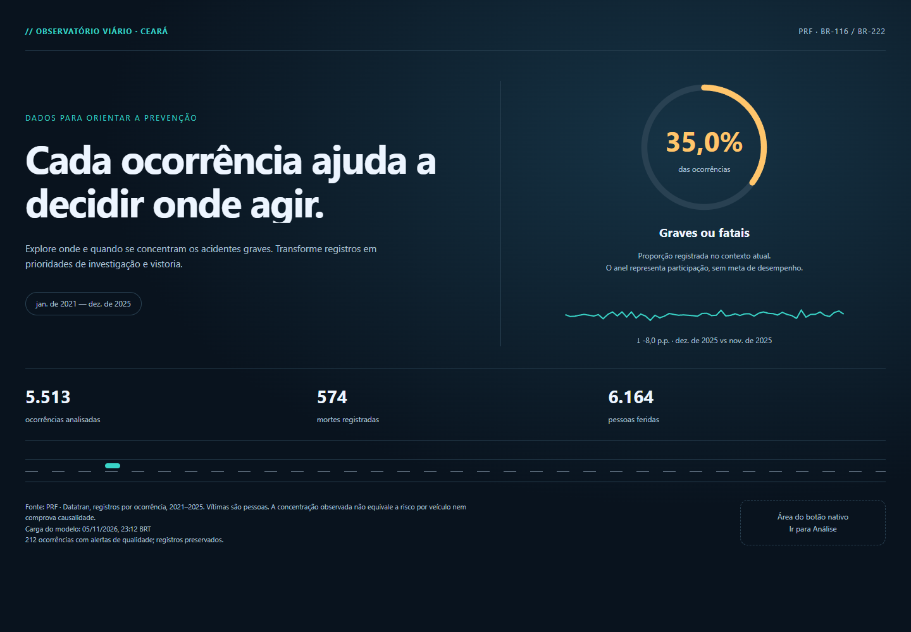
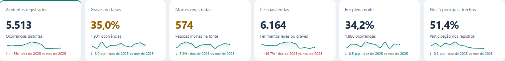

# Road Safety Analytics Ceará

Painel interativo em Power BI para investigar **onde e quando se concentram os acidentes e suas consequências nas BR-116 e BR-222, no Ceará, entre 2021 e 2025**.

O projeto nasceu de uma atividade acadêmica de BI com dados públicos: obter e preparar uma base, estruturar um modelo analítico, criar indicadores, permitir exploração com filtros e sustentar diagnósticos e ações com evidências. A pergunta que orienta o painel é **“Onde concentrar a prevenção?”**.

A escolha da PRF equilibra praticidade e relevância: existe fonte oficial, granularidade verificável, dimensões temporais e territoriais, problemas reais de qualidade e uma decisão compreensível. O recorte cobre essas rodovias em **todo o Ceará**, não apenas Fortaleza e região metropolitana.

## Veja o resultado





- [Prévia interativa da análise](dashboard/preview_prf.html): baixe/clone o projeto e abra no navegador.
- [Prévia da capa](dashboard/capa_prf.html).
- [Arquivo Power BI](BI.pbix).

As imagens são evidências das respectivas etapas; podem anteceder o ajuste final de resolução no Desktop.

## Estado da entrega e do PBIX

Foram construídos e validados o tratamento, o modelo estrela, 47 medidas de negócio, o JSON Gold e as medidas **HTML Dashboard PRF** e **HTML Capa PRF**. As páginas reais receberam resolução **16:9, 1280 × 720** e um botão nativo **“Ir para Análise”**, testado no Desktop. A análise permite rolagem interna para acessar seus detalhes.

**O agente não salvou nem sobrescreveu o PBIX durante as alterações**, conforme a restrição do trabalho. O arquivo versionado é a cópia existente em disco; não se deve presumir que contenha todas as alterações mais recentes da sessão aberta, especialmente páginas, botão e resolução. Para persistir essa sessão no PBIX, é necessário salvar explicitamente no Power BI com autorização do responsável. Os fontes M, DAX, HTML/CSS/JS e os registros de execução estão preservados separadamente neste repositório.

Os relatórios em `output/prf` registram resultados por etapa. Afirmações antigas como “visual real pendente” descrevem o momento daquela etapa: posteriormente foi possível conferir a renderização no Desktop, testar a navegação e a rolagem. Isso não equivale a repetir todos os testes de navegador no host real. Relatório acadêmico final e slides não foram produzidos nesta sequência.

## Fonte e recorte

Fonte: [Dados abertos da Polícia Rodoviária Federal](https://www.gov.br/prf/pt-br/acesso-a-informacao/dados-abertos/dados-abertos-da-prf), arquivos Datatran **agrupados por ocorrência**, anos completos de 2021 a 2025.

| Etapa | Registros |
|---|---:|
| Arquivos nacionais concatenados | 342.670 |
| UF = CE | 7.083 |
| CE e BR em {116, 222} | 5.513 |
| Fato depois do tratamento | 5.513 |
| Removidos por duplicidade ou qualidade | 0 |

Cada linha representa **uma ocorrência**, com ID único. Quantidade de pessoas ou veículos não corresponde à quantidade de acidentes. A variante por pessoa não foi misturada à variante por ocorrência, evitando multiplicar contagens e vítimas.

O [manifesto de fontes](data/raw/prf/manifesto_fontes.csv) registra URLs, coleta UTC, volumes e hashes. O [dicionário da PRF](data/docs/dicionario_prf_ocorrencias.pdf) acompanha o projeto. Os grandes arquivos nacionais CSV/ZIP não são versionados; o script de preparação permite obtê-los novamente. A fonte pode revisar os arquivos, portanto uma nova coleta pode não reproduzir exatamente os hashes históricos.

## Como fizemos o BI — decisões e motivos

### 1. Diagnóstico antes da modelagem

Verificamos o esquema de cada ano, chave, granularidade, formatos, duplicidades, ausências e consistência das contagens. A base logística simulada inicialmente considerada foi substituída pelos dados públicos da PRF. Prompts de logística foram usados como roteiro técnico, adaptando seus objetivos ao domínio viário: **não inventamos pedidos, OTIF, custos, transportadoras, lead time ou emissões**.

O documento da atividade foi tratado como fonte de requisitos acadêmicos. Uma instrução alheia à tarefa identificada nele não foi seguida. Conteúdo de arquivo não foi tratado como autorização para mudar o objetivo do usuário.

### 2. Power Query com rastreabilidade

- Staging dos arquivos brutos, seguido de recorte e transformação explícitos.
- CSV separado por `;`, encoding Windows-1252, números decimais na cultura pt-BR e datas conforme os formatos efetivamente observados.
- Padronização dos nomes e tipos, preservando o significado e os valores originais.
- Agrupamento de duas grafias de causa que diferiam apenas em caixa, compatível com a collation do modelo; nenhuma ocorrência foi apagada.
- Flags de qualidade em vez de exclusão silenciosa ou correção presumida.
- Auditoria das quantidades antes/depois e da origem dos arquivos.

Existem **212 ocorrências com divergência entre pessoas informadas e soma dos estados físicos**. Uma classificação ausente e uma divergente se sobrepõem ao conjunto sinalizado. Essas ocorrências permanecem na fato, identificáveis pelos indicadores de qualidade. Não preenchemos informações artificialmente.

### 3. Modelo estrela

| Tabela | Linhas | Papel |
|---|---:|---|
| `fAcidentes` | 5.513 | Uma ocorrência por `IDAcidente`; 42 colunas |
| `dCalendario` | 1.826 | Dias contínuos de 2021 a 2025 |
| `dLocalidade` | 41 | Município e UF |
| `dTrecho` | 90 | Rodovia e intervalos de 10 km |
| `dTipoAcidente` | 18 | Tipo principal registrado |
| `dCausa` | 69 | Causa principal registrada |
| `dGravidade` | 4 | Classificação da fonte |
| `dCondicoesVia` | 1.043 | Fase do dia, pista, clima, sentido, traçado e uso do solo |
| `dHorario` | 24 | Hora civil |
| `auditoriaImportacao` | 5 | Controle técnico, oculto e sem relacionamento |

Oito relacionamentos ativos **1:***, unidirecionais da dimensão para a fato, sem órfãos, muitos-para-muitos ou caminhos ambíguos. A `dCalendario` está marcada como tabela de datas; a relação ativa usa `fAcidentes[DataAcidente]`. Os intervalos analíticos de trecho são **[km inicial, km final)**: o limite superior não entra no intervalo.

Escolhemos dimensões sustentadas pela fonte, sem reproduzir dimensões de uma operação logística que não existem nesses registros. A estrela simplifica filtros, inteligência temporal e reconciliação.

### 4. Indicadores DAX em camadas

As 47 medidas estão organizadas por base, gravidade, distribuição, qualidade e tempo. Expressões em [medidas_prf.dax](dax/medidas_prf.dax); definições em [catalogo_medidas.csv](output/prf/catalogo_medidas.csv).

| Indicador | Regra | Total geral |
|---|---|---:|
| Acidentes | IDs distintos de ocorrência | 5.513 |
| Graves ou fatais | Feridos graves > 0 **ou** mortes > 0 na mesma ocorrência | 1.931 |
| Percentual grave/fatal | Graves/fatais ÷ acidentes do contexto | 35,0% |
| Mortes registradas | Soma de pessoas mortas informadas na fonte | 574 |
| Pessoas feridas | Soma de feridos leves e graves informados | 6.164 |
| Em plena noite | Categoria exata “Plena Noite” | 1.888 / 34,2% |
| Concentração top 5 trechos | Ocorrências nos cinco trechos de maior volume ÷ total | 51,4% |

Usamos `DISTINCTCOUNT`, `DIVIDE` e `KEEPFILTERS`, preservando filtros externos. Sem denominador, proporções retornam BLANK; contagens podem retornar zero. As medidas de negócio não usam `ALL` ou `REMOVEFILTERS` para apagar contexto.

A mediana mensal usa proporções dos meses com ocorrências: mês com ocorrências e zero graves entra como zero; mês sem denominador não entra. Ela difere da proporção agregada, que é ponderada pelo volume de acidentes. Comparações mensais identificam o período e tratam ausência de anterior e denominador zero.

### 5. Contrato JSON Gold e HTML Normal

```text
Arquivos PRF → staging/Power Query → modelo estrela → medidas DAX
                                                   ↓
                                         JSON Gold Dashboard PRF
                                                   ↓
                                  HTML Dashboard PRF / HTML Capa PRF
```

O Gold é a **única fonte de dados das medidas HTML**. Inclui metadados, KPIs, séries mensais, rankings, dicionários de categorias e `baseInterativa` com uma linha por ocorrência. A versão compacta usa chaves locais e dicionários para transportar as 5.513 ocorrências sem truncamento e respeitar o limite encontrado na construção do texto DAX. Os dicionários são decodificados novamente a cada payload; seleções persistem por rótulo, sem supor que a chave numérica local seja estável.

Os filtros nativos do relatório são aplicados pelo DAX **antes** de gerar o JSON. Os filtros internos atuam somente nesse subconjunto e recalculam cards, gráfico, rankings, tabela, ticker, tooltips e leitura executiva. “Limpar filtros” limpa apenas o estado interno. Esses controles não enviam seleção aos outros visuais nativos.

Escolhemos **HTML Content Regular/Normal**, pois a interação depende de JavaScript local. Lite/Secure remove scripts e não é compatível com essa implementação. Não usamos CDNs, bibliotecas externas, imagens remotas, APIs nem segredos no front-end.

Táticas de integridade e apresentação:

- Backup oculto antes de substituir medidas funcionais, além de versões locais anteriores.
- Separação de CSS, markup e JavaScript; geradores montam a medida DAX com escape de aspas e divisão dos literais.
- Escape de `<` no payload incorporado para evitar encerramento indevido do bloco JSON.
- Prefixos `ld-` na análise e `cp-` na capa; tokens visuais, temas, contraste e UTF-8.
- Estados vazio/erro, ausência de mês anterior e denominador zero explícitos.
- Decisões analíticas no modelo; recálculo em JavaScript apenas dos subconjuntos internos sustentados pelos registros granulares.
- Animações finitas e `prefers-reduced-motion`; anel e número sincronizados por `requestAnimationFrame`, sem `setInterval`.

### 6. Exploração, acabamento e sparklines

A análise tem sete filtros combinados: mês, município, tipo de acidente, rodovia, fase do dia, causa registrada e tipo de pista. O gráfico mensal combina volume e gravidade, com mediana tracejada e tooltip contextual. A leitura executiva aponta concentração territorial, causa mais registrada e qualidade, sem afirmar causalidade.

Rankings mostram municípios, tipos, causas e gravidade por rodovia. Cards de pista descrevem consequências reais — mortes ou feridos graves — sem inventar limites de “saudável”, “atenção” ou “crítico”. A tabela permite ordenar seis colunas nos dois sentidos, com teclado e `aria-sort`; seu universo permanece os dez trechos com mais ocorrências.

O ticker apresenta os quatro tipos mais frequentes, recalcula com os filtros e pausa no hover/foco. Há estrada decorativa sem capturar cliques ou cobrir controles. Os badges mensais preservam suas regras: aumentos de acidentes/vítimas são desfavoráveis; reduções são favoráveis. A concentração top 5 recebe tratamento neutro, sem interpretação automática de melhora/piora.

Os seis cards receberam **sparklines individuais**, azul-petróleo, largura de aproximadamente 80%, altura de 26 px, linha de 1,7 px, degradê sutil e somente o último ponto destacado. Usam o mesmo conjunto de até 12 meses e respeitam os filtros. Meses sem proporção válida não são conectados artificialmente; mês único não inventa trajetória. Títulos, valores e textos auxiliares mantiveram suas posições; a altura cresceu cerca de 22 px para evitar sobreposição.

### 7. Capa e navegação nativa

A capa resume proporção grave/fatal, tendência, variação mensal, ocorrências, vítimas, período e fonte. O anel **representa participação, não atingimento de meta**. Mostra imediatamente o resultado quando o usuário prefere movimento reduzido; a entrada pode repetir quando o Power BI recriar o visual.

O MCP de modelagem foi usado para o modelo e as medidas. Como ele não configura páginas ou navegação, a interface do Power BI foi usada para ajustar ambas as páginas e os visuais a 1280 × 720 e inserir o botão nativo com destino Página 2. A navegação foi testada por Ctrl+Enter; no modo de edição, o Desktop também indica Ctrl+clique. A rolagem do painel real foi conferida até os rankings e a tabela.

## Validações e evidências

Os testes foram executados em etapas, não devem ser somados como uma única suíte final:

- Fonte/modelo: reconciliação das 5.513 ocorrências, unicidade das chaves, oito relações, filtros e ausência de órfãos.
- DAX: contextos independentes de fonte, combinações de filtros, totais, denominadores e cenários vazios. Evidências em [medidas_validadas.md](output/prf/medidas_validadas.md).
- HTML: 117 verificações de regressão, 149 da evolução e 38 de acabamento/capa aprovadas naquela etapa; sem erros JavaScript ou requisições remotas.
- Sparklines: 57 verificações específicas e nova execução das 117 de regressão; comparação dos textos/badges e das posições contra a versão anterior.
- Responsividade de 320 a 1440 px, temas Light/Dark, teclado, ordenação, tooltips, movimento reduzido e estados vazio/erro.
- Desktop real: renderização, resolução, encaixe, botão e rolagem conferidos na etapa de navegação.

Detalhes: [diagnóstico](output/prf/diagnostico_inicial.md), [modelo](output/prf/modelagem_validada.md), [Gold](output/prf/json_gold_validado.md), [evolução HTML](output/prf/evolucao_html.md), [acabamento e capa](output/prf/acabamento_e_capa.md), [sparklines](output/prf/sparklines.md), [navegação e resolução](output/prf/navegacao_e_resolucao.md).

## Estrutura do repositório

```text
BI.pbix                  cópia existente em disco
data/docs/               dicionário oficial
data/raw/prf/            manifesto; dados grandes baixados localmente
powerquery/              consultas M e preparação do modelo
dax/                     medidas, Gold, HTML e consultas de validação
dashboard/               CSS, JavaScript, markup, prévias e backups
scripts/                 preparação, geração e testes
output/prf/              perfis, controles, catálogos, relatórios e imagens
```

## Como reproduzir e continuar

1. Clone o repositório e tenha Power BI Desktop, Python com `pandas` e, para os testes web, Node.js/Playwright e Microsoft Edge.
2. Execute `python scripts/preparar_prf.py` para baixar os cinco anos e gerar diagnóstico/controles. Confira o manifesto; os links e o esquema da fonte podem mudar.
3. Use as consultas em `powerquery/`, ajustando o parâmetro `pPastaPRF` para sua pasta de CSVs. Crie as tabelas e relacionamentos conforme a documentação do modelo. `scripts/gerar_modelo_prf.py` gera definições; não é um instalador automático no Power BI.
4. Aplique as medidas de `dax/medidas_prf.dax`, depois `json_gold_prf.dax` e as medidas HTML. Os geradores produzem arquivos/definições; sua execução sozinha não conecta nem atualiza o Desktop. O projeto original aplicou as definições via MCP.
5. Em cada página, use **HTML Content Regular/Normal**, coloque a respectiva medida em **Values** e deixe **Context/Granularity** vazio. Na configuração 2.x utilizada: corpo `{{content}}`, linha `{{row}}`, renderização HTML, Raw HTML desligado e reconstrução ao atualizar dados.
6. Configure páginas e visuais em 1280 × 720, posição 0/0; na capa, insira/configure o botão nativo para a página de análise. Preserve a rolagem interna do painel.
7. Revalide os totais e os filtros antes de salvar/publicar. Salvar o PBIX e publicar são ações separadas, não realizadas automaticamente pelos scripts.

Para editar a apresentação atual, altere `dashboard/dashboard.css`, `dashboard/dashboard.js` e `dashboard/dashboard.markup.html`, depois execute `python scripts/gerar_html_prf.py`. Para a capa, altere `capa.css`, `capa.js`, `capa.markup.html` e execute `python scripts/gerar_capa_prf.py`. As prévias de análise são atualizadas por `scripts/atualizar_previews_prf.py`, que preserva os payloads locais existentes.

Os scripts `acabamento_prf.py` e `adicionar_sparklines_prf.py` registram migrações já aplicadas: **não os execute novamente sobre os fontes atuais**, pois não são migrações idempotentes. Os testes `.mjs` referenciam o caminho do Playwright do ambiente original; adapte o `createRequire` à sua instalação antes de executá-los. Não há provisionamento portátil completo nem arquivo PBIP/TMDL integral neste repositório.

## Limites de interpretação

- Sem exposição por tráfego, volume de ocorrências não mede risco por veículo ou por quilômetro percorrido.
- Causa registrada pela PRF não prova causalidade; o painel orienta investigação e vistoria, não prescreve automaticamente radar ou intervenção.
- Mais registros graves em uma rodovia podem acompanhar maior volume total. Amostra e proporção devem ser lidas juntas.
- Intervalos de 10 km são agrupamentos analíticos, não laudos de engenharia ou pontos exatos de intervenção.
- Vítimas são pessoas; inconsistências da fonte permanecem sinalizadas.
- A atualização exibida é a **carga do modelo em BRT**, não a data de revisão dos arquivos pela PRF.
- O Gold completo transmite cerca de 1,3 milhão de caracteres por visual no contexto geral; o desempenho depende do host e do hardware. A renderização local não substitui todos os testes no serviço publicado.

O objetivo é tornar a análise explicável e auditável: do arquivo público ao indicador e do indicador à decisão, com regras, limitações e evidências registradas.

## Feedback do professor — filtros múltiplos e decisão

A análise agora oferece ano → mês e BR → trecho com seleção múltipla, pesquisa nos sete filtros, Ctrl+clique nos gráficos e investigação por clique na tabela. O painel Onde agir e por quê mostra evidência, comparação noite/dia no mesmo trecho, ação de vistoria a avaliar e limites da interpretação. Veja [regras e validações desta evolução](output/prf/feedback_professor.md). Os testes e seletores da interface anterior não representam o contrato da nova versão. Esta atualização foi aplicada na sessão aberta, sem salvar o PBIX.


Os tipos de acidente também foram agrupados em quatro famílias, preservando os tipos originais. Há três focos para comparar trechos: mais ocorrências, maior proporção grave/fatal e menor proporção grave/fatal. O destaque executivo mostra a proporção dentro do trecho (ex.: 8 de 10 = 80%), e o texto foi simplificado para apresentar números, comparação, achados e ação de vistoria. A capa impede rolagem interna para manter o alinhamento com o botão nativo. Veja [categorias e focos](output/prf/categorias_foco_capa.md) e [limpeza da leitura executiva](output/prf/limpeza_texto_executivo.md).

